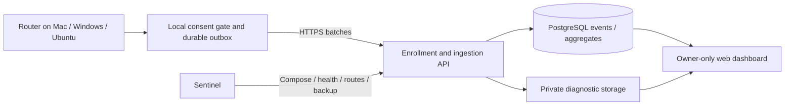

# Central telemetry and Sentinel deployment — design, 2026-10-11

Status: **implemented locally; public activation and native acceptance pending**.
The repository now includes the FastAPI/PostgreSQL backend, consent-aware durable
client outbox, shared Settings controls, private owner panel and Sentinel Compose
artifacts. No DNS, production deployment or owner installation was changed.
The canonical endpoint is `https://router.andreifaur.dev`; availability is not
asserted. See [the operator runbook](CENTRAL-TELEMETRY-OPERATIONS.md) for exact
commands, limits, credential custody, verification and remaining gates.

Implementation refinements: diagnostic JSON lives privately in PostgreSQL and is
included in its backup; the separate volume holds deletion intents. The initial
read-only panel uses HTTP Basic over HTTPS, so it has no cookie/CSRF state. Batches
are bounded uncompressed JSON; larger raw OTLP records are counted as rejected.
Collection occurs on new journal appends rather than historical tail scanning;
crash/lock gaps are explicitly best-effort as documented in the runbook.

## Confirmed product choices

- One Settings switch enables/disables central metrics. Ordinary users enter no
  URL, API key, account, Docker configuration or Sentinel configuration.
- Metrics sharing starts disabled. Existing local telemetry/prompt settings do
  not grant remote consent and must not be migrated into remote opt-in.
- Prompts and raw OTLP require additional explicit permission, separate from
  metrics. Use independent prompt and raw-OTLP controls beneath the main switch.
- The first dashboard is private to the owner. No end-user statistics accounts
  or multi-user dashboard are required for this first delivery.
- **No automatic server-side deletion**: events, aggregates and opted-in diagnostic
  content remain until deliberately removed. The owner rejected proposed timed
  retention. Capacity limits must not silently purge old data to make room.
- Deploy/operate the backend through Sentinel. Its configuration is a one-time
  operator responsibility, never an end-user setup requirement.

## User flow and consent lifecycle

In Settings, add `Compartir métricas para mejorar el enrutador`, followed by a
short explanation of fields and destination. Show whether sharing is off,
connecting, up to date, queued/offline or blocked, with last successful sync and
pending count. Avoid raw server errors, credentials and conversation details.
Enabling creates a random installation identity and a scoped write credential
through automatic HTTPS enrollment. Store the credential using the native
secret-storage adapter; do not embed a universal publisher/ingestion secret in
public source or binaries. No hardware fingerprint, user email or chat title is
needed for installation identity.

Additional controls explain the actual contents of prompts and OTLP before
sharing. Raw telemetry may contain content or sensitive attributes; it is not
anonymous merely because it is telemetry. Never describe lossless raw uploads as
redacted. Any secret filtering/rejection must be explicit and counted, not an
undocumented assumption that all content is safe. Do not add response/attachment
capture implicitly; evaluate each new content source separately.

Disabling the master switch closes the local upload gate immediately, cancels
queued/in-progress work where possible, and prevents automatic replay of the old
consent period after re-enabling. An already transmitted request may finish;
revocation cannot recall bytes already delivered. Extra permissions are suspended
with the master gate and are not silently restored on the next activation.
Maintain consent epochs and reject queued work with obsolete consent. Local
capture settings and existing local history remain independent.
`Eliminar mis datos enviados` is a separate deliberate action backed by the
installation credential. Do not conflate pausing with server deletion. If a user
loses the credential, the owner needs a separate recovery/support procedure;
no accountless recovery is promised. Restores must reapply deletion tombstones
so manual deletion is not undone by restoring an older backup.

## Architecture

Implementation: a FastAPI service, PostgreSQL and a small private web
panel, isolated from the Desktop routing process. Ship one cross-platform Python
uploader and shared Settings UI, using existing native secret-storage adapters.
An initial backend can serve the panel itself; separate frontend deployment is
not a prerequisite. Diagnostic content uses private PostgreSQL rows outside Git/public assets, with
authenticated attachment access and separate permissions.
No remote outage may block native inference, phase changes or monitor startup.

## Data and identity contract

Reuse the reviewed field allowlist/evidence semantics from
`src/codex_model_router/telemetry/evidence.py`, not repeated whole ZIP exports.
The current `router-evidence/2` export creates a new random HMAC key on every
export. Its pseudonyms are intentionally inconsistent across exports, so naive
periodic export/upload cannot deduplicate a continuous stream reliably.

Define a versioned ingestion schema and durable per-event ID before queueing;
scoped pseudonyms are stable only inside the installation. Retries retain the
same IDs; PostgreSQL uniqueness on `(installation_id, event_id)` prevents
at-least-once delivery from duplicating observations. Installation reset is a
new cohort, not a fictitious continuation. Preserve runtime/process identity for
cumulative counters: snapshots are not additive events and must not simply be
summed across polls or restarts. Store event and receipt time separately.

Collect source/product/router/policy/Desktop versions, OS/architecture, routing
engine, task class, requested/accepted/observed model and effort, phase transitions,
latency, token counts, failures/retries/cancellations and quality/check results.
Keep `confirmed`, `probable`, `correlated` and unknown attribution distinct;
accepted settings do not establish a later inference. Missing identity, missing
costs and missing feedback remain unknown, not zero/success. Preserve real versus
synthetic workloads and actual versus estimated costs. Do not sum cached input
or reasoning output twice. Initial metrics uploads exclude content, original
conversation identifiers, filenames/paths, environment and credentials.

Quality/cost conclusions need outcome evidence and comparable tasks, not only
model distribution or elapsed time. Reports must show coverage, failed samples,
software cohorts, clock/provenance uncertainty and collection losses.

## Delivery and ingestion reliability

Use bounded disk-backed batches, acknowledgement after durable
commit, retry/backoff and server deduplication. Persist cursor advancement only
with queue creation/acknowledgement, so restart cannot silently skip events.
Maintain explicit counters for malformed/rejected/duplicate/over-limit events.
Queue and content limits are configuration of the product/operator, not setup
fields for ordinary users. On capacity exhaustion, stop the affected capture or
upload with visible status; do not silently delete retained server data.

Automatic anonymous enrollment is publicly reachable and therefore untrusted.
A per-install write token provides isolation/revocation, not proof of a unique
human or authentic app binary. Require enrollment and ingestion rate/size limits,
strict schemas, decompression budgets, token quotas and cohort filtering. Do not
build product conclusions from submissions as if client identity attested truth.
Tokens never grant access to the owner panel or other installations. Separate
admin authentication, appropriate CSRF protections for any future mutating browser actions, and owner-managed secrets
are required. Reject redirects to arbitrary hosts when carrying credentials.

## Verified Sentinel integration boundary

Read-only review: Sentinel checkout `354464b` on2026-10-11, canonical repository
`https://github.com/Bogdan-Andrei-Faur/Sentinel.git`. Review sources:
`AGENTS.md`, README project YAML contract, shared `ProjectYAMLConfig` and backup
resource declarations, `core/deploy-manager.ts`, `core/deploy-health.ts` and
`core/env-template.ts`. No Sentinel files, database, Caddy state or running service
were modified. Current deployed Sentinel revision is not inferred from checkout.

The implementation must provide:

| Item | Application-side contract |
| --- | --- |
| Compose | Repository-owned compose path, backend and private PostgreSQL services, predictable Compose service names; no privileged mode or Docker socket |
| Public access | Backend on external `sentinel-public` network; Sentinel route `router.andreifaur.dev` points to its container/port; database has only private networking |
| Health | Cheap liveness and readiness endpoints; readiness checks database/schema and storage access without revealing records or credentials |
| Configuration | Document operator env names and generate secrets outside Git. Accept Sentinel's deploy-scoped env files; never rewrite committed `.env` or generated Caddyfile |
| Migration | Explicit noninteractive Compose migration command and schema detect file, compatible with Sentinel deploy environment; do not hide destructive migrations in startup |
| Backup | Declare PostgreSQL plus diagnostic volume as persistent resources; never call this project stateless. Restore verification includes schema, blobs and deletion tombstones |
| Rollback | Build from recorded immutable source/image; backward-compatible migrations for retained app version; restore/recovery procedure documented and fixture-tested |
| Packaging | Explicit backend build inputs; exclude `state/`, logs, prompts, keys, downloads and existing native build outputs from Docker context/image |

Register the application through Sentinel's UI or supported project configuration;
no Sentinel-specific runtime SDK is needed in Router. Host-local health exposure
must match the actual Sentinel machine and deployment configuration, rather than
assuming this developer Mac is the production host. DNS/TLS/registration and
production activation remain separate from local Compose verification.

## Implementation sequence and acceptance

1. Backend/schema: automatic enrollment, scoped ingestion, consent epochs,
   deduplication, health and admin authentication. Test isolated databases only.
2. Client outbox and Settings controls: no setup fields; independent diagnostic
   permissions; cross-platform native secret storage and graceful offline state.
3. Private panel: installations/cohorts, routing/usage, failure/quality and evidence
   coverage; deliberate deletion and storage/capacity visibility.
4. Compose, migrations, backup declarations and exact Sentinel operator runbook.
5. End-to-end fixtures: opt-in/off, re-enable, crash/retry, duplicate batches,
   oversized/untrusted input, revoked tokens, permission separation, cross-install
   access denial, manual deletion/restore and server unavailable throughout routing.
6. Prepare a concrete Sentinel deployment for owner review, then activate the
   selected hostname and verify TLS/enrollment/upload/admin access using synthetic
   data. Install client update only at an owner-approved maintenance window.

This document records choices and the implementation contract; it neither activates
remote collection nor replaces existing local evidence. Native real
installation and public service acceptance require their own actual receipts.
