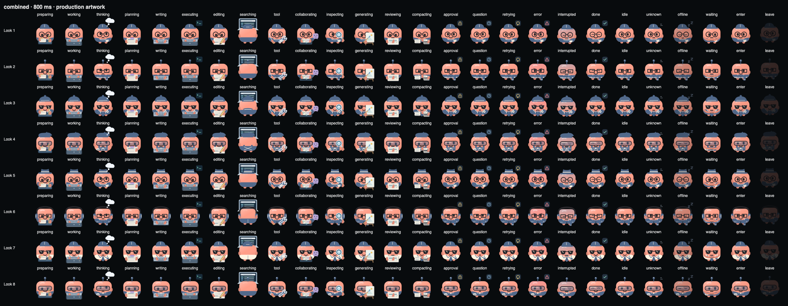

# Companion wardrobe and animation review — 2026-10-10

## Corrections

- Working/executing: keyboard faces the character; viewer sees the back of the
  laptop lid. Hands paint between keyboard and lid, and survive prop transitions.
  Executing uses a separate terminal callout, never commands on the lid back.
- Editor and option cards use an idle frontal cosmetic preview even when the live
  agent works, searches, compacts, requests approval/input, fails or disconnects.
  Saving/cancelling restores the real activity; the preview does not alter live state.
- Compact avatars no longer contain a context bar. Hover, accessible avatar labels
  and expanded meters retain zero/full/unknown/compacting context semantics.
- Search has rear garment artwork: no front lapels, bib pockets or front buttons
  on the back. Existing front-only glasses, neckwear and details remain hidden from
  the rear; returning to a frontal state restores the selected wardrobe.

## Evidence and limits

33 JS core tests, all 15 browser groups and 3 Python preview-isolation tests pass.
The rigidity group now checks 36 looks: 3 base palettes, every non-empty option
in all five slots (25), and 8 combined looks with both rounding/eye variants.
Each runs in all 26 states, at 38/142 px and eight timeline positions: **14,976
samples**, with fixed body dimensions, rigid transforms and contained geometry.
This is not the exhaustive Cartesian product of every possible wardrobe choice.

Visual review uses the production renderer with synthetic data: five complete
slot sheets plus combined looks, each at 800/2000 ms. The editor screenshot shows
clothes without live props. Natural prop occlusion during work is intentional;
the appearance editor remains unobstructed. The gallery contains 26 regenerated
GIFs and a manifest with source hashes. Native Mac/Windows/Ubuntu rendering and
owner visual acceptance are separate and remain pending for this source revision.



## Reproduce

```sh
node tests/test_monitor_rigidity.cjs
ROUTER_TEST_BROWSER=chromium npm run test:layout
node tools/render_companion_wardrobe.cjs
ROUTER_GIF_PYTHON=/path/to/python-with-pillow node tools/render_companion_gifs.cjs
```

Wardrobe sheets go to ignored `output/playwright/wardrobe/` (override with
`ROUTER_WARDROBE_OUTPUT`). Only synthetic fixture data is used.

## Delivery

No install, Desktop restart, commit, push or Release publication occurred. Preserve
active agents and existing local packaging work. The previously prepared 0.9.7 Mac
pilot does not contain these fixes: rebuild a separately identified candidate and
coordinate installation after owner work finishes.
